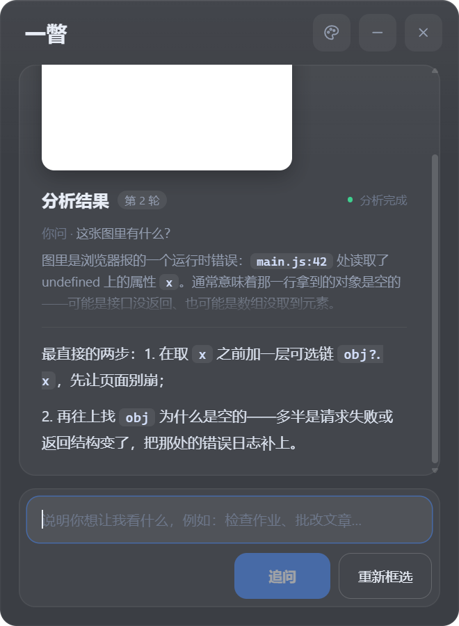
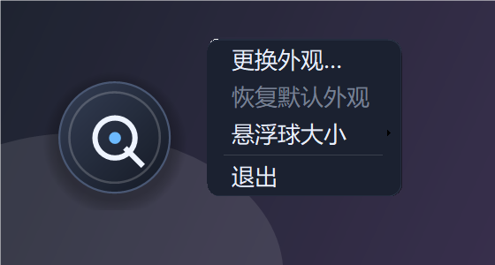
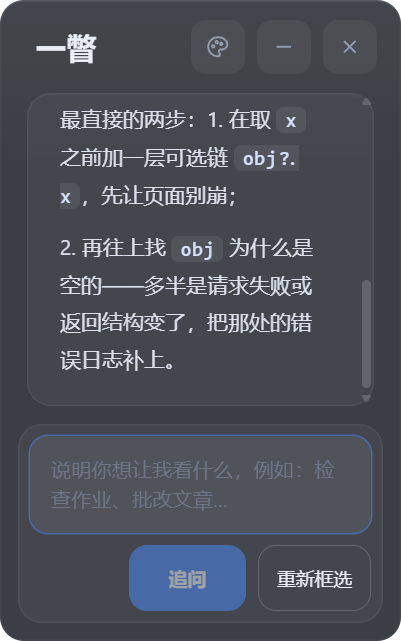

# 一瞥 / Glance

> 屏幕上任何一个角落，框一下，就有一条能追问的 AI 分析线索。

一个 **DSH Desktop 本地插件**。点会话标题栏的「一瞥」，屏幕角落出现一个置顶悬浮球；点球框选任意应用的区域，截图直接发给多模态模型，分析结果在悬浮面板里流式显示，还能就着这张图继续追问。

   [](https://github.com/waterfish111/dsh-glance/actions/workflows/ci.yml)

更新日志：[CHANGELOG.md](CHANGELOG.md) ｜ 完整说明：[docs/MANUAL.md](docs/MANUAL.md) ｜ 许可证：[MIT](LICENSE) ｜ 当前版本：`0.5.2`（beta）



---

## 它解决什么问题

报错弹窗、公式推导、看不懂的图表、想改的 UI、外语截图——这些时候你要么来回切换窗口复制粘贴，要么截图丢给聊天窗口还得重新描述一遍。

一瞥把这套动作压成两步：**框一下，问一句**。而且它知道你在问哪张图：追问只发文字，不再重传截图。

它不适合：需要批量 OCR 的文字提取、需要长文档总结的场景、非 Windows 环境。

## 快速开始

### 1. 环境要求

| 项 | 要求 |
| --- | --- |
| 系统 | Windows 10 / 11 |
| 宿主 | DSH Desktop（本地 profile 插件机制） |
| 运行时 | Microsoft Edge WebView2 Runtime（Win11 通常自带，Win10 可能需手动装） |
| 脚本 | Windows PowerShell 5.1（系统自带，`widget.ps1` 依赖它） |
| 模型 | 默认的 DeepSeek-V4.1-Flash 原生支持图片，**不需要额外装插件**；换成纯文本模型才会失败 |

### 2. 安装

把仓库放到任意本地目录（不要放在需要管理员权限的位置），然后：

```powershell
dsh plugin --profile desktop add 'link:D:/path/to/dsh-glance'
```

打开 `%USERPROFILE%\.dsh\profiles\desktop\package.json`，确认 `dsh.profile.bundles` 数组里有 `"@local/dsh-glance"`，没有就加一行：

```json
"dsh": { "profile": { "bundles": [ "...", "@local/dsh-glance" ] } }
```

> **只写进 `dependencies` 不会加载。** `dsh.profile.bundles` 才是决定加载哪些 bundle 的层列表；插件管理器界面做的事本质也是这两步。

重启 DSH Desktop。会话标题栏出现「一瞥」按钮即安装成功。

### 3. 第一次用

1. 点标题栏「一瞥」→ 屏幕出现悬浮球，按钮变成「运行中」
2. 点悬浮球 → 屏幕冻结，拖出要分析的矩形
3. 面板里看截图，可写一句补充说明（"这报错什么意思"／"帮我改这个 UI"）
4. 点「发送」→ 回答流式出现在「分析结果」里
5. 接着输入 → 按钮变「追问」→ 只发文字，不再重传截图

## 使用

### 悬浮球

| 操作 | 效果 |
| --- | --- |
| 左键单击 | 进入框选 |
| 拖动 | 换位置（不会误触发框选） |
| 右键单击 | 打开菜单：更换外观 / 恢复默认外观 / 悬浮球大小 / 退出 |



「悬浮球大小」有 4 档：小 `72` / 标准 `84` / 大 `96` / 特大 `108`（DIP）。选择立即生效，写进 `settings.json`，下次启动沿用；尺寸跟着屏幕缩放换算，换到高 DPI 屏不会缩水。

### 面板

- **发送 / 追问**：首轮带截图，之后只带文字
- **停止**：真正中断 Harness 里这一轮（调 `sessionController.cancel`），不只是把面板的流停掉；已生成的部分会留下并标注「已停止」
- **重新框选**：换一张图，开新的一条线索
- **标题栏**：调色板 = 换外观（自定义后变 ↺）；— = 收起面板；× = 收起面板（球保留）



一次框选 = 一条线索。新截图自动开新会话，追问复用同一条；会话标题带时间（`一瞥 · 11-05 19:32`），方便事后在 DSH 会话列表里翻回来。同一张图追问到第 6 轮会给一句软提示，提醒你换话题时可以重新框选。

### 命令

| 命令 | 效果 |
| --- | --- |
| `/glance` 或 `/glance status` | 查询是否在运行 |
| `/glance on`（也接受 `start` / `enable`） | 启动悬浮球，幂等 |
| `/glance off`（也接受 `disable`） | 关闭悬浮球 |

## 工作原理

三个进程/线程，三条单向管道：

```
DSH 主进程 (index.js)                 widget.ps1 (PowerShell + WinForms)
  │  stdin  ── {type:"ready"|"capture"|"followup"|"abort"} ──▶ │
  │  ◀── stdout ── {type:"analysis-delta|replace|done|error"} │
  │                                    │
  │                                    │ WebView2 postMessage
  │                                    ▼
  │                              panel.html (界面)
  └──────── HTTP GET /api/local/dsh-glance/status ──▶ client.js (标题栏按钮轮询)
```

- **Host 半（`index.js`）**：注册 `/glance` 命令与状态路由，起停 `widget.ps1` 子进程，把截图拼成 image prompt 发给专用会话，用 `sessionController.follow` 把流式回答回灌给面板
- **Widget 半（`widget.ps1`）**：PowerShell 5.1 + WinForms + 内嵌 WebView2。分层窗口画悬浮球（`UpdateLayeredWindow` 逐像素 alpha），全屏冻结层取框选，`panel.html` 跑在 WebView2 里
- **Web 半（`client.js`）**：往会话标题栏塞一个启动按钮，每 2 秒向宿主查一次真实状态

没有 OCR、没有本地推理：截图以 base64 直接进模型上下文。

## 文件与数据

| 位置 | 内容 |
| --- | --- |
| `%LOCALAPPDATA%\dsh-glance\state.json` | 当前线索（v2：`sessionId` / `title` / `startedAt` / `turns`） |
| `%LOCALAPPDATA%\dsh-glance\settings.json` | 悬浮球大小 `{"ballSize":96}` |
| `%LOCALAPPDATA%\dsh-glance\ball.png` | 自定义的悬浮球图片 |
| `%LOCALAPPDATA%\dsh-glance\WebView2\` | WebView2 用户数据目录 |
| `%TEMP%\glance-host.log` | 宿主侧日志（命令、会话创建、取消、失败原因） |
| `%TEMP%\glance-widget.log` | 小部件侧日志（DPI、框选、WebView2 初始化、菜单动作） |

状态文件旧格式（v1，扁平 `{sessionId,title}`）会在首次启动时自动升级，升级后旧文件可删。

## 已知限制

**会话与上下文**

- 面板只展示当前这一条线索：最新一轮完整显示，之前的问答收成可点开的气泡；更早的线索请去 DSH 会话列表里找
- 「停止」中断的是 Harness 这一轮，但不会撤回已经进入队列的消息；被中断的回答可能缺结尾
- 发送失败会自动重试一次，重试会再发一遍同样的内容，模型侧可能看到重复提问
- 分析会话在 DSH 里被删除时，会自动新建并在面板顶部提示，旧上下文不再保留

**界面与显示**

- 自定义外观只做等比缩放：图片不是正方形时四周留空；原图小于 128×128 会被放大变糊
- 自定义外观不区分悬停态；「分析中」的进度环画在图片外侧
- 标题栏按钮每 2 秒轮询一次，所以从球菜单退出后，按钮最多 2 秒才变回「一瞥」

**环境**

- 仅 Windows + DSH Desktop；WebView2 缺失时会弹窗给出安装地址
- 只用单屏 2560×1600 @150% 验证过；多屏混合 DPI、竖屏、远程桌面尚未系统测试
- 宿主与 widget 之间没有协议版本握手：如果两者版本不一致（例如只更新了一半），不会明确报"版本不匹配"

## 排错

**标题栏没有「一瞥」按钮**
插件没被加载。检查 `dsh.profile.bundles` 里有没有 `@local/dsh-glance`，然后重启 DSH。

**点了按钮，球没出来**
看 `%TEMP%\glance-host.log` 与 `%TEMP%\glance-widget.log` 的最后几行。最常见是 WebView2 Runtime 缺失（会有弹窗），或 `widget.ps1` 被安全软件拦截。

**球出来了，点球没反应**
首次初始化 WebView2 需要一两秒，等一下再点。仍然无反应就看 `glance-widget.log` 里的 `webview init` 相关行。

**面板是空白的**
面板加载的是 `file://` 下的 `panel.html`，路径里不要有会被特殊处理的字符；同时确认 `webview2\` 三个 DLL 还在原位。

**分析一直失败**
多半是当前会话选的模型不接受图片输入。默认的 DeepSeek-V4.1-Flash 在 DSH 内置模型目录里声明了 `inputModalities: ["text", "image"]`，开箱即用、不需要装任何插件；但如果在模型选择里换成了纯文本型号，图片会被直接拒收——换回带视觉的模型再试。面板会显示具体错误，可以据此区分「模型不收图片」和「网络/鉴权失败」。

**发送后卡在「分析中」**
看 `glance-host.log` 里有没有 `prompt` 失败或 `cancel`；也可以在面板点「停止」后再发一次。

## 隐私

- 截图只发送到你在 DSH 里配置的模型服务商，插件不向其他服务上传任何东西
- 自定义外观图片复制到 `%LOCALAPPDATA%\dsh-glance\ball.png`，仅本机保存
- 屏幕捕获只在你主动框选时发生，不后台持续截屏
- 插件本体不额外落盘截图（`-SelfTest` 自测模式除外，它会写一张到 `%TEMP%`）
- 日志里不记录截图内容，只记录流程与错误

## 卸载

```powershell
dsh plugin --profile desktop remove @local/dsh-glance
```

再从 `dsh.profile.bundles` 里删掉 `"@local/dsh-glance"`，重启 DSH。本地数据可留可删：`%LOCALAPPDATA%\dsh-glance\`。

## 开发

```
index.js              Host 半：命令、会话、子进程、图片 prompt、流式回传
client.js             Web 半：标题栏启动按钮 + 状态轮询
widget.ps1            原生小部件：悬浮球、冻结框选、WebView2 面板宿主
panel.html            面板页面（单文件 HTML/CSS/JS）
cordis.patch.yml      DSH bundle 声明
webview2/             vendored WebView2 SDK（Core / WinForms / Loader）
locale/ icon.svg      文案与图标
test/                 回归测试
```

**测试**

```powershell
npm run check                               # 一键：JS 语法 + 宿主协议/停止链路 + 面板脚本编译
npm test                                    # 只跑测试（9 项断言 + 面板内联脚本）
powershell -STA -File .\widget.ps1 -SelfTest # 小部件自测：起面板、截图、退出，exit 0 为通过
```

`-SelfTest` 需要能写 `%LOCALAPPDATA%`，跑完会在 `%TEMP%` 留一张 `glance-selftest.png`。

**注意**

- `widget.ps1` 必须保持 UTF-8 **带 BOM**：PowerShell 5.1 读无 BOM 文件会按 ANSI 解码，中文全变乱码且解析失败。`.gitattributes` 已固定 `*.ps1` 按 CRLF 检出
- 宿主与 widget 之间的消息是裸 JSON 行，改协议要同时改 `index.js`、`widget.ps1`、`panel.html` 三处
- 改完 `widget.ps1` 记得重启 DSH：宿主会把脚本作为子进程常驻，不会热更新

## 版本

完整历史见 [CHANGELOG.md](CHANGELOG.md)。

| 版本 | 主题 |
| --- | --- |
| `0.5.2` | 修「会话已失效」提示不显示；补完整说明书；加本地自检与 CI |
| `0.5.1` | 悬浮球 4 档大小；自定义外观去掉黑色投影 |
| `0.5.0` | 一次框选一条线索：会话生命周期、面板多轮气泡、停止保留文本 |
| `0.4.5` | 状态改轮询宿主；修菜单首次打开偏小、文字贴边 |
| `0.4.4` | 标题栏开关改成启动按钮；右键菜单按面板视觉重做 |
| `0.4.3` | 悬浮球右键菜单（换外观 / 恢复默认 / 退出） |
| `0.4.2` | 「停止」真正中断 Harness 这一轮 |
| `0.4.1` | 悬浮球重做 + 按 DPI 缩放 + 自定义图片；面板避开球 |
| `0.4.0` | 追问不再重传截图；停止；DPI 面板尺寸；删死代码 |
| `0.3.0` | 改名「一瞥 / Glance」；WebView2 面板、流式分析 |
| `0.2.x` | 最初的冻结框选与截图分析原型 |

## 第三方

WebView2 SDK 的版权与许可见 `webview2/LICENSE.txt`。本仓库自身代码以 MIT 许可证发布，见 [LICENSE](LICENSE)。
